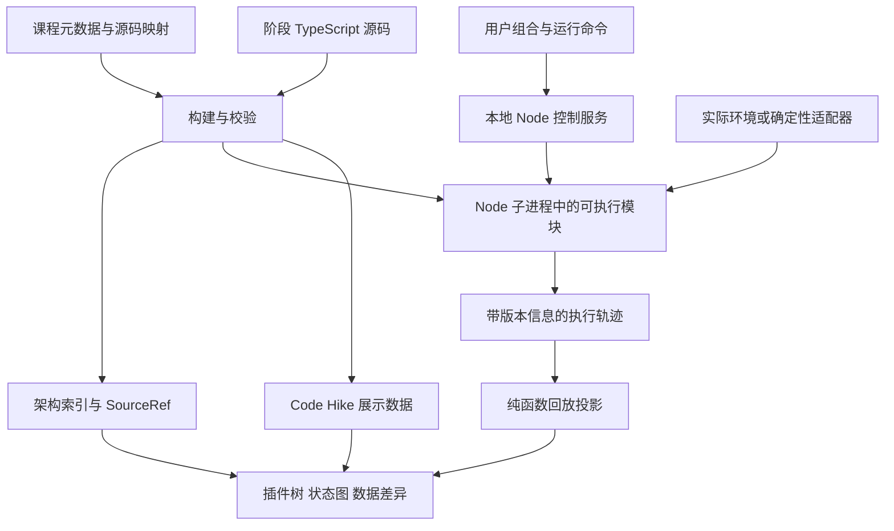
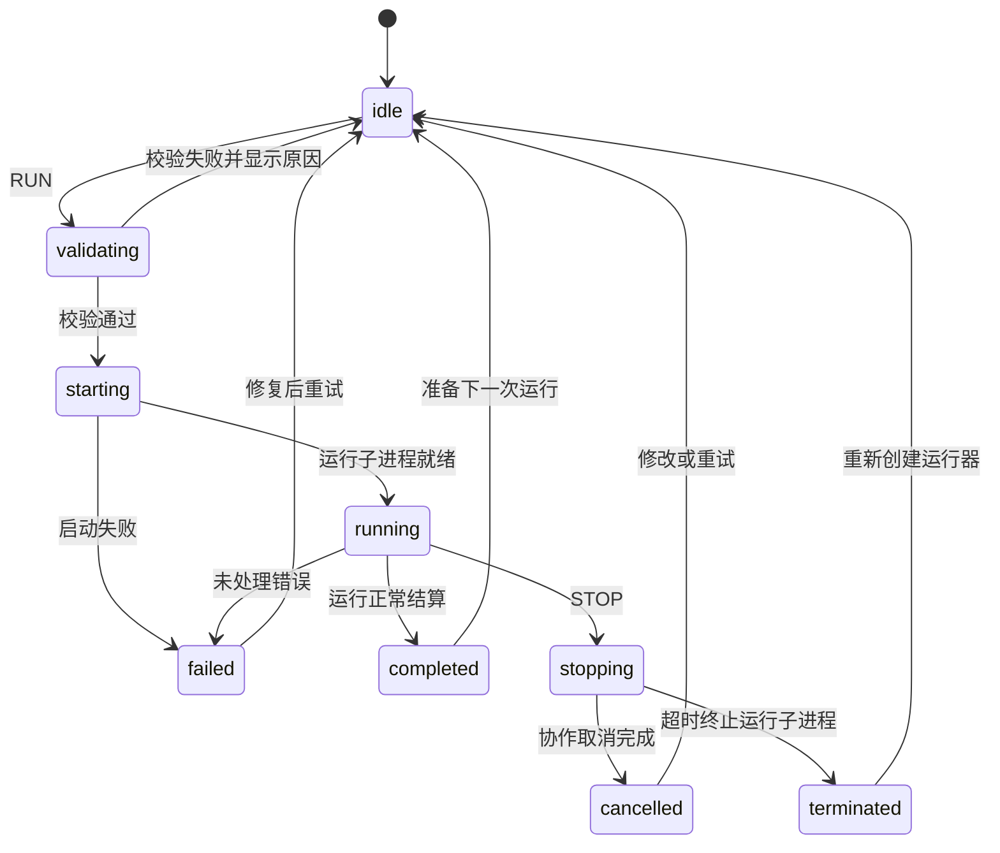

# 系统架构与状态数据模型

## 1 架构原则

运行时拥有执行事实；轨迹记录器捕获事实；回放器从记录派生历史视图；界面展示派生结果。Code Hike 只负责代码呈现，不能承担执行逻辑。

采用 Node 承载实际执行、浏览器承载交互可视化的本地应用。原有“组合与源码 → 执行 → 轨迹 → 回放投影 → 可视化”的数据流保持不变，只改变执行位置与观测来源。优先复用固定版本的上游插件和 Cordis 基础机制；需要精简以满足教学目标时，实现经契约验证的教学子集。此选择必须在阶段 0 固定，不能在内容制作中反复切换。

不把上游改写成一个任意定义的全局状态机。XState 主要控制本产品的编辑、执行、回放流程。教学运行时保留各领域的状态与控制结构，UI 阶段只是对它们的可解释投影。

## 2 总体数据流



构建产物必须带同一个 sourceHash。加载器在开始运行前检查阶段源码、展示数据和执行模块是否匹配，不匹配则拒绝执行。

## 3 技术选型

| 层 | 选择 | 原因和边界 |
|---|---|---|
| 包管理 | pnpm workspace | 共享类型、运行时、内容工具和测试夹具 |
| 前端框架 | Next.js + React + TypeScript | Code Hike 官方提供该方向的入门方式，支持 MDX 和构建期处理 |
| 代码教学 | Code Hike + MDX | 高亮、焦点、差异、多步骤和代码过渡；执行由自有运行器提供 |
| 图 | React Flow | 节点选择、自定义节点、关系图层；受控数据来自统一投影 |
| 布局 | 初期稳定树布局，复杂图引入 ELK | 避免每次事件导致全图重新排列 |
| 实验控制 | Node 端 XState | 全局状态机协调插件树运行，明确命令、守卫、失败和停止流程 |
| 视图选择 | Zustand | 存储选中实例、面板、缩放和游标，不复制运行事实 |
| Schema | Zod | 本地 API、子进程消息、内容清单、导入轨迹的运行时验证 |
| 执行宿主 | Node.js 控制服务 + 独立运行子进程 | 读取本机环境、执行受信任预构建模块；运行异常与强制停止不终止控制服务 |
| 存储 | IndexedDB，封装 repository 接口 | 保存实验配置和有上限的运行记录 |
| 测试 | Vitest + Playwright | 语义契约、回放、内容编译和浏览器闭环 |
| 构建源码 | TypeScript + esbuild | 完整类型检查后打包阶段模块；产出文件哈希和映射 |

以上是选型，不是假定依赖已经安装。阶段 0 验证 Code Hike、MDX、React、Next.js 的兼容组合后写入 lockfile，不混用旧版 @code-hike/mdx 示例与当前 codehike API。

默认交付本地 Node 应用，规划启动命令为 `pnpm explorer`（尚未实现）。Node 控制服务提供运行命令与轨迹订阅，浏览器展示构建期处理的 MDX、源码和 manifest。前端可作为静态资源提供，但纯静态托管不再是完整应用的交付目标。Node 运行子进程执行受信任的预构建模块，不增加任意源码编译服务。

## 4 目录与依赖方向

```text
apps/
  explorer/                   # Next.js 可视化 UI
  local-server/               # Node 启动入口、本地 API、运行子进程管理
packages/
  contracts/                  # 公共 DTO、Zod schemas、事件与源码引用类型
  teaching-runtime/           # 教学执行语义，不依赖 React
  teaching-plugins/           # 精简插件及各可运行阶段
  trace/                      # 记录格式、纯投影、检查点、差异
  lesson-kit/                 # 内容校验、源码提取、阶段构建、manifest
content/
  plugins/<plugin-id>/         # MDX 讲解、架构元数据、阶段与场景清单
fixtures/
  scenarios/                  # 输入、确定性模型脚本、内存文件
  upstream/                   # 固定版本的规范化行为夹具及来源
scripts/
  verify-source-links.ts
  build-lessons.ts
  verify-lessons.ts
  compare-upstream.ts
docs/
  contracts/                  # 插件/能力行为契约
  decisions/                  # 经验证后锁定的技术决定
  generated/                  # 覆盖报告与实现状态索引
```

依赖方向：contracts 被其他包使用；runtime 不导入 UI、MDX 或内容解释；trace 依赖 contracts，运行时通过窄 recorder 接口写入 trace；lesson-kit 消费插件源码和内容，不被运行器反向调用。

本地 Node 服务属于同一个应用，不引入远程后端、数据库服务或插件市场。运行命令通过本地 HTTP API 发送，轨迹经 SSE 订阅；Node 与运行子进程通过 IPC 交换同一套协议消息。服务默认仅绑定回环地址，写命令检查启动会话凭据与请求来源。密钥、Context 和资源句柄不传给浏览器。

## 5 核心领域实体

以下类型为本项目设计草案，不是上游 API 原文。

```ts
type PluginInstanceId = string
type ScopeId = string
type RunId = string
type JsonValue = null | boolean | number | string
  | JsonValue[] | { [key: string]: JsonValue }

interface SourceRef {
  id: string
  origin: 'teaching' | 'upstream'
  revision: string        // 教学内容版本或上游完整 commit
  path: string
  symbol?: string
  startLine: number      // 构建生成，不由课程作者手填
  endLine: number
  contentHash: string
}

interface PluginInstance {
  id: PluginInstanceId
  definitionId: string
  stageId: string
  scopeId: ScopeId
  parentId: PluginInstanceId | null
  enabled: boolean
  config: JsonValue
}

interface ExperimentRevision {
  id: string
  contentVersion: string
  runtimeVersion: string
  upstreamCommit: string
  composition: Composition
  scenarioId: string
  scenarioHash: string
  input: JsonValue
  seed: number
  revisionHash: string
}
```

插件包、实例和作用域分开标识。同一个插件多次挂载不能被包名合并。服务解析边保存消费者、解析作用域和最终提供者，不能仅以服务名连接全图。

### 5.1 插件定义、实例与运行状态

定义描述可加载的代码及各教学阶段；实例描述一次挂载的配置；运行状态描述该实例在某次运行中的事实。实例配置不保存 active 等实际状态，也不保存服务对象或函数。

```ts
interface PluginDefinition {
  id: string
  title: string
  lessonId: string
  stageIds: readonly string[]
}

interface ScopeDefinition {
  id: ScopeId
  parentId: ScopeId | null
}

interface Composition {
  instances: readonly PluginInstance[]
  scopes: readonly ScopeDefinition[]
}

interface RuntimeError {
  name: string
  message: string
  sourceRefIds: string[]
}

interface PluginRuntimeState {
  instanceId: PluginInstanceId
  phase: 'pending' | 'loading' | 'active' | 'failed' | 'unloading' | null
  dependencyStatus: 'unknown' | 'missing' | 'resolved'
  reason: string | null
  lastError: RuntimeError | null
  resourceIds: string[]
}
```

ExperimentRevision.composition 显式保存插件组合与作用域。插件父子关系和作用域父子关系分别校验，不通过节点位置推断服务可见性。定义、阶段和源码通过 contentVersion 定位；服务依赖声明归属于具体可执行阶段，因为阶段代码会改变依赖要求。实际解析结果另存消费者、解析作用域、服务键和提供者。

### 5.2 全局运行状态与环境边界

```ts
type RuntimePhase = 'idle' | 'validating' | 'starting' | 'running'
  | 'stopping' | 'completed' | 'cancelled' | 'terminated' | 'failed'

interface RuntimeState {
  phase: RuntimePhase
  runId: RunId | null
  revisionId: string | null
  plugins: Record<PluginInstanceId, PluginRuntimeState>
  error: RuntimeError | null
}

interface EnvironmentSnapshot {
  nodeVersion: string
  platform: string
  cwd: string
  variables: Array<{
    name: string
    present: boolean
    sensitive: boolean
  }>
}
```

RuntimeState 属于 Node 全局运行控制器；浏览器订阅其序列化状态。plugins 是当前运行的实例状态索引，必须与实际观测一致。全局 running 不要求所有插件都 active；单实例失败是否终止运行，由场景的必需能力和生命周期契约决定，具体失败策略仍待确定。

EnvironmentSnapshot 关联 runId 写入运行元数据，只采集本次使用的环境信息，不枚举保存整个 process.env。实际环境变量值、模型客户端、Context、函数和 disposer 留在 Node 内部；快照、请求及诊断信息在传输和持久化前脱敏。环境快照是来源说明，不保证可变外部环境可以被完整复现。

## 6 状态所有权

### 6.1 实验控制状态机

Node 端状态机拥有全局执行控制权。未运行时为 idle；草稿编辑属于独立工作流，运行中仍可编辑草稿。



RUN 必须绑定已经校验的不可变实验版本。运行中编辑只生成草稿，不修改正在运行的版本。停止后必须区分协作取消与强制终止，后者不能声称清理已完成。

### 6.2 插件生命周期

从上游公开 inventory 已确认的 phase 是 pending、loading、active、failed、unloading、null。该接口是快照，不足以反推出完整合法转换表；阶段 0 必须阅读 Cordis 的 Fiber/Loader 实现和测试，补齐转换契约。

教学运行时可以有额外诊断字段 dependencyStatus、reason、lastError，但不能把这些解释字段冒充上游 phase。特别是 null 仅表示无活动 root Fiber，不等于“卸载成功”或“从未启动”。

禁止前端按定时器把 pending 自动推进到 active。只有实际激活结果能产生状态改变。

### 6.3 Agent 运行状态

上游控制流程由函数、异步边界、事件和日志共同表达，不假定存在一份现成 FSM。实现时建立“源码分支 → 教学检查点 → 前后条件”的映射。

展示阶段可以包括等待输入、准备请求、模型流式返回、执行工具、结算，但这些是 UI 投影。实际轨迹保留 agent/pre-step、agent/request、llm/stream、tools/* 等已覆盖事件，以及 turn/*、step/*、tool/* 等持久 Session 事件。

重点约束：pre-step 拒绝/首批空输入可能关闭 turn 而没有 step；工具结果可能要求下一次请求；准备请求取消不能提前提交 system/user；重试不应被错误展示为重新组装所有输入。具体版本行为在契约中核实。

### 6.4 阅读与回放状态

独立保存 lessonStepId、selectedSourceRefId、selectedInstanceId、selectedRunId、replayCursor。切换阅读步骤不自动推进运行；移动回放游标不重新执行插件。

“跟随执行”只是选择逻辑：检查点到来时选中关联代码。关闭后用户可以阅读任意代码，运行继续进行。

## 7 组合编译与依赖解析

草稿通过 compileComposition 转成执行计划。检查项包括定义和阶段是否存在、配置合法、父子树无环、实例 ID 唯一、作用域可见性、必需服务、同域冲突以及当前教学实现不支持的特性。

依赖图与树分开生成。依赖可能是动态注册，不能声称静态分析能发现所有关系。图边标注 declared、resolved 或 observed，分别表示声明、实际解析和实际调用。

最小对话组合候选包括 session、system-prompt、tools、agent、agent-loop、llm 和确定性适配器，但只是待验证清单。是否需要投影等附加服务，由实际实现与契约确认。没有使用工具不意味着一定可以移除工具服务，因为 Loop 可能依赖其接口。

第一版只编辑显式教学组合 JSON。Profile/Bundle/Patch 的完整覆盖规则作为后续实验；不把简单配置对象合并宣称为上游 Patch 语义。

## 8 精简运行时

运行时接口最小包括 mount、unmount、startScenario、cancel、dispose。它加载编译后的插件阶段模块，并通过服务与事件机制执行。

推荐实现顺序：Context/作用域 → 服务依赖 → 注册资源与释放 → 事件分发 → Session → 提示词 → 工具 → Agent Loop → 模型适配。

精简不是按包大小裁剪。每个删减必须列出被排除的行为；不支持的输入或配置显式拒绝，不静默使用不同语义。

waterfall 必须保留 around-middleware 语义：外层进入、next 委托、内层返回、外层返回。不能实现成将值逐个传递的数组 reduce。同步/异步和返回规则按具体事件契约确定，不统一为一种 Promise 广播。

确定性模型不是直接播放最终轨迹。模型适配器根据实际请求匹配脚本分支并产出流或工具调用；其余事件、日志和状态仍由运行时代码生成。请求不符合预期时场景应失败，让错误实现暴露出来。

## 9 轨迹协议

```ts
interface TraceRecord {
  schemaVersion: 1
  runId: RunId
  seq: number                   // 单次运行单调递增
  logicalTime: number
  kind: 'lifecycle' | 'service' | 'dispatch' | 'session'
      | 'checkpoint' | 'data' | 'diagnostic'
  name: string
  instanceId?: PluginInstanceId
  scopeId?: ScopeId
  spanId?: string
  parentSpanId?: string
  causeSeq?: number
  sessionId?: string
  turnId?: string
  stepId?: string
  sourceRefIds: string[]
  beforeRef?: string
  afterRef?: string
  payloadRef?: string
}

interface RunManifest {
  runId: RunId
  experimentRevisionId: string
  runtimeVersion: string
  contentVersion: string
  upstreamCommit: string
  environmentSnapshotRef: string
  adapterMode: 'deterministic' | 'real'
  sourceHashes: Record<string, string>
  scenarioHash: string
  mode: 'teaching' | 'upstream-reference'
  outcome: 'running' | 'completed' | 'failed' | 'cancelled' | 'terminated'
  lastSeq: number
  completeness: 'complete' | 'truncated'
}
```

大型值按内容寻址放入 payload store，记录保存引用。捕获时序列化不可变快照，不能保存以后会变化的对象引用。错误标准化为 name、message、sourceRef，不传递函数或原始 Context。

所有事件先通过统一 recorder 分配 seq。并发记录的 seq 是观察到的总顺序，不是因果证明；真实依赖用 span、parentSpan 和 causeSeq 表达。

框架临时事件、Session 持久事件、教学检查点属于不同 kind，避免同名或相似名称混淆。动画播放速度不得影响 logicalTime 或事件顺序。

## 10 Node 通信与可靠性

浏览器到 Node 的运行命令：LOAD_REVISION、RUN、CANCEL、DISPOSE。后续才加入 PAUSE_AT_CHECKPOINT 和 CONTINUE。

命令 envelope 包含 protocolVersion、commandId、runtimeGeneration、runId 和 payload。响应包括 ACK、TRACE_BATCH、SNAPSHOT、RUN_SETTLED、ERROR。ACK 仅表示命令接收，不能等同于运行完成。

- 消息用 Zod 校验；未知版本拒绝处理。
- 每次启动运行子进程增加 generation，旧 generation 的晚到消息被丢弃。
- TRACE_BATCH 使用 seq 区间，重复记录去重；缺口显式报告，不静默插值。
- RUN_SETTLED 携带 finalSeq，浏览器确认已收齐后才展示完整结果。
- 记录按数量或短时间窗口批量发送；不为每个 token 重渲染整棵树。
- 超过配置的事件/字节上限时停止采集或运行，并标记 truncated；不得把缺失尾部判为成功。
- 运行超时先请求协作取消，超过清理期限才终止运行子进程；控制服务继续运行。

Node 子进程用于生命周期管理和故障隔离，不是恶意代码安全沙箱。第一版只执行项目构建时确定的受信任模块，不提供 eval、任意 URL 导入或用户粘贴执行。

浏览器刷新不重新执行场景。重连按 runId、runtimeGeneration 和最后连续 seq 补发记录；如果记录已不可用，显式标记缺口。运行事实和全局状态由 Node 持有，浏览器不维护第二份可独立推进的执行状态机。

## 11 回放与快照

用纯函数 reduceTrace(previous, record) 产生 ViewSnapshot。快照包括当前实例状态、服务解析、注册项、当前请求、工具执行状态和 Session 投影。

每隔一定记录数保存检查点快照；初始值可为 100 条，依据实际 payload 大小调优。跳转时加载最近检查点再前向归约，而不是调用任意反向业务操作。

回放零点是该运行的初始状态。UI 必须从运行绑定的组合初始化，不能从当前草稿初始化。轨迹版本未知、sourceHash 不匹配时，允许只读查看元数据，但不误配代码高亮。

## 12 单步执行边界

第一版只要求回放单步。后续在教学运行时的语义检查点调用 scheduler.yield(checkpoint)，由暂停控制器决定继续或等待。

暂停只能发生在声明过的检查点，不是任意 JavaScript 行。取消需能打断等待中的暂停。涉及并发分支时要展示仍在运行的任务，不宣称全局原子冻结。

测试对比开启/关闭检查点时的规范化执行结果，确认插桩未改变语义。真实外部模型和系统调用接入后，暂停不代表外部操作停止。

## 13 存储和版本演进

Node 控制服务保留有容量上限的当前运行状态、轨迹与 payload 缓冲，支撑刷新重连；这不代替历史运行持久化。第一版继续由浏览器 IndexedDB 保存历史记录，超出缓冲保留范围的重连显式报告缺口。

IndexedDB stores：experimentDrafts、experimentRevisions、runManifests、traceChunks、payloads、progress。localStorage 只存小型 UI 偏好。

运行记录写入失败不影响当前内存结果，但显示“未保存”。提供导出/导入包含 manifest 和 schemaVersion 的 JSON 包；导入只读数据，不执行其中代码。

保留策略按记录数和总字节数双重限制，删除时清理未被引用的 payload。优先实现主动清空与容量提示，自动淘汰必须保护用户标记保留的记录。

## 14 性能目标

以固定测试环境记录基线，不预先宣称已达到：50 个实例、5,000 条小型轨迹、10 MB 以内 payload 的标准实验中，回放跳转 p95 小于 200 ms；普通界面点击反馈小于 100 ms；新增节点不重置视口。

大代码高亮在构建期完成；按插件拆分内容；轨迹列表虚拟化；图选择器按实例订阅。先测量再引入布局 Worker、更多缓存或复杂状态中间层。
