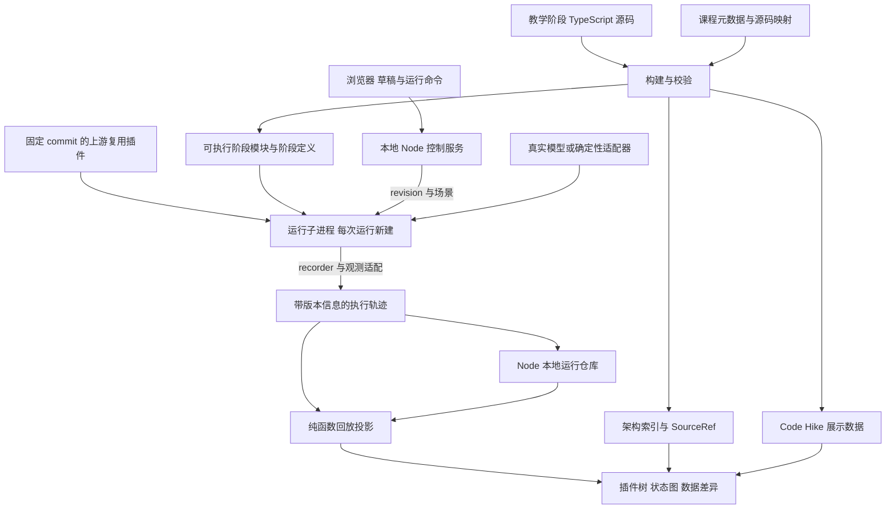
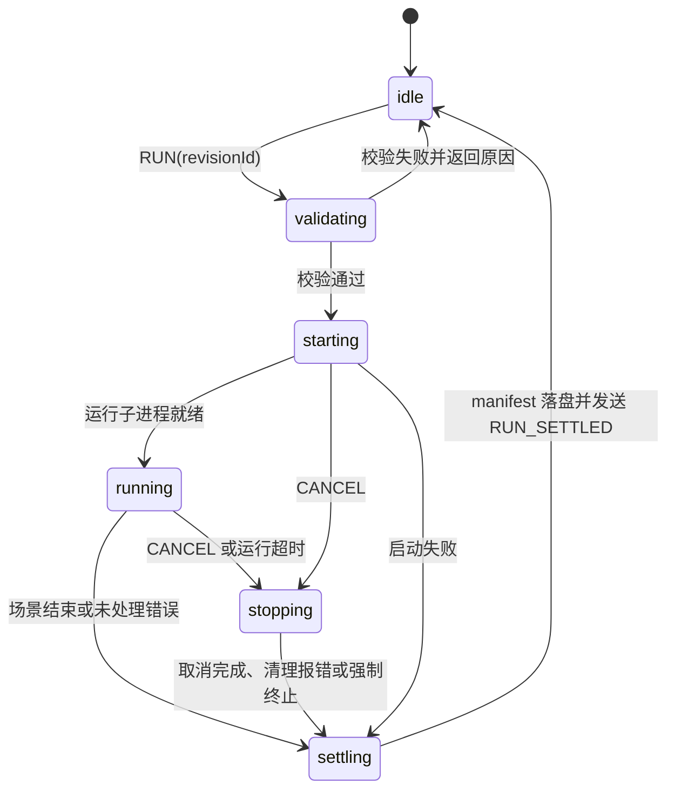

# 系统架构与状态数据模型

## 1 架构原则

运行时拥有执行事实；轨迹记录器捕获事实；回放器从记录派生历史视图；界面展示派生结果。Code Hike 只负责代码呈现，不能承担执行逻辑。

采用 Node 承载实际执行、浏览器承载交互可视化的本地应用。原有“组合与源码 → 执行 → 轨迹 → 回放投影 → 可视化”的数据流保持不变，只改变执行位置与观测来源。

插件实现分两种来源。被讲解的插件使用本项目的分阶段教学实现；其余基础插件（如 session、llm、agent-loop）在 P0-04 验证可行时直接复用固定 commit 的上游实现，否则使用经契约验证的教学子集。两类插件可以出现在同一组合中，但每个实例都标明来源：不把上游实现当作分阶段教学代码讲解，也不把教学实现称为上游原文。复用范围在阶段 0 固定，不能在内容制作中反复切换。

不把上游改写成一个任意定义的全局状态机。XState 只用于 Node 端的运行控制（校验、启动、停止、结算）；草稿和实验版本由 Node 实验仓库管理，阅读与回放状态由浏览器的 Zustand 保存。教学运行时保留各领域的状态与控制结构，UI 阶段只是对它们的可解释投影。

## 2 总体数据流



构建产物必须带同一个 sourceHash。上游复用插件以 upstreamCommit 和包内容哈希标识。控制服务在启动运行前检查阶段源码、展示数据和执行模块是否匹配，不匹配则拒绝执行。

## 3 技术选型

| 层 | 选择 | 原因和边界 |
|---|---|---|
| 包管理 | pnpm workspace | 共享类型、运行时、内容工具和测试夹具 |
| 前端框架 | Next.js + React + TypeScript，静态导出 | Code Hike 官方提供该方向的入门方式；MDX 与高亮在构建期处理，产物由 Node 控制服务托管 |
| 代码教学 | Code Hike + MDX | 高亮、焦点、差异、多步骤和代码过渡；执行由自有运行器提供 |
| 图 | React Flow | 节点选择、自定义节点、关系图层；受控数据来自统一投影 |
| 布局 | 初期稳定树布局，复杂图引入 ELK | 避免每次事件导致全图重新排列 |
| 运行控制 | Node 端 XState | 只协调一次运行的校验、启动、停止和结算；不管理草稿与回放 |
| 视图选择 | Zustand | 存储选中实例、面板、缩放和游标，不复制运行事实 |
| Schema | Zod | 本地 API、子进程消息、内容清单、导入轨迹的运行时验证 |
| 执行宿主 | Node.js 控制服务 + 每次运行新建的子进程 | 读取本机环境、执行受信任预构建模块；运行异常与强制停止不终止控制服务 |
| 存储 | Node 本地文件仓库，封装 repository 接口 | 草稿、实验版本、运行记录、payload 和学习进度；浏览器只存 UI 偏好 |
| 测试 | Vitest + Playwright | 语义契约、回放、内容编译和浏览器闭环 |
| 构建源码 | TypeScript + esbuild | 完整类型检查后打包阶段模块；产出文件哈希和映射 |

以上是选型，不是假定依赖已经安装。阶段 0 验证 Code Hike、MDX、React、Next.js 的兼容组合后写入 lockfile，不混用旧版 @code-hike/mdx 示例与当前 codehike API。

默认交付本地 Node 应用，规划启动命令为 `pnpm explorer`（尚未实现）。默认采用单进程、单端口、同源的方案：local-server 同时托管前端构建产物和本地 API，不另起 Next.js 服务器，也不需要 CORS。Code Hike 推荐的 RSC 只在构建期使用。开发时由 local-server 反向代理 Next.js 开发服务器，浏览器端仍然同源。若 P0-03 证明静态导出无法满足 Code Hike 或 MDX 需求，改为由 Next.js custom server 承载同一套 API，仍保持单进程单端口。

启动流程：检查构建产物与 sourceHash → 打开本地运行仓库并处理未结算运行 → 启动控制服务 → 在终端打印带一次性令牌的本地 URL。纯静态托管不是完整应用的交付目标；运行子进程只执行受信任的预构建模块，不增加任意源码编译服务。

## 4 目录与依赖方向

```text
apps/
  explorer/                   # Next.js 可视化 UI（静态导出）
  local-server/               # Node 启动入口、前端托管、本地 API、运行仓库、运行子进程管理
packages/
  contracts/                  # 公共 DTO、Zod schemas、阶段定义、场景、事件与源码引用类型
  teaching-runtime/           # 教学执行语义，不依赖 React
  teaching-plugins/           # 精简插件及各可运行阶段
  upstream-bridge/            # 上游复用插件的加载与观测适配（P0-04 决定复用时建立）
  trace/                      # 记录格式、纯投影、检查点、差异
  lesson-kit/                 # 内容校验、源码提取、阶段构建、manifest
content/
  plugins/<plugin-id>/         # MDX 讲解、架构元数据、阶段与场景清单
fixtures/
  scenarios/                  # 场景步骤、确定性模型脚本、内存文件
  upstream/                   # 固定版本的规范化行为夹具及来源
scripts/
  verify-source-links.ts
  build-lessons.ts
  verify-lessons.ts
  compare-upstream.ts
docs/
  contracts/                  # 插件/能力行为契约
  decisions/                  # 经验证后锁定的技术决定
  generated/                  # 覆盖报告与实现状态索引
.explorer/                    # 本地运行仓库，运行时生成，不提交
```

依赖方向：contracts 被其他包使用；runtime 不导入 UI、MDX 或内容解释，只读取构建生成的 ExecutableStageDefinition；trace 依赖 contracts，运行时和 upstream-bridge 通过窄 recorder 接口写入 trace；lesson-kit 消费插件源码和内容并生成阶段定义，不被运行器反向调用。

本地 Node 服务属于同一个应用，不引入远程后端、数据库服务或插件市场。实验仓库操作和运行命令通过本地 HTTP API 发送，轨迹经 SSE 订阅；控制服务与运行子进程通过 IPC 交换同一套协议消息。

访问控制：

- 默认只绑定 127.0.0.1；校验 Host 头，只接受 localhost 或 127.0.0.1 加实际端口，防止 DNS rebinding。
- 启动时生成随机会话令牌，只出现在终端打印的 URL 中；首次访问时换成 HttpOnly、SameSite=Strict 的会话 cookie。API 读写和 SSE 订阅都需要该会话，因为轨迹本身含请求原文和本机数据。
- 写请求另外校验 Origin 与服务自身同源；不开放 CORS。
- 密钥、Context、模型客户端和资源句柄不离开 Node。

## 5 核心领域实体

以下类型为本项目设计草案，不是上游 API 原文。

```ts
type PluginInstanceId = string
type ScopeId = string
type RunId = string
type JsonValue = null | boolean | number | string
  | JsonValue[] | { [key: string]: JsonValue }

interface SourceRef {
  id: string
  origin: 'teaching' | 'upstream'
  revision: string        // 教学内容版本或上游完整 commit
  path: string
  symbol?: string
  startLine: number      // 构建生成，不由课程作者手填
  endLine: number
  contentHash: string
}

interface PluginInstance {
  id: PluginInstanceId
  definitionId: string
  stageId: string         // 必须指向 ExecutableStageDefinition
  scopeId: ScopeId
  parentId: PluginInstanceId | null
  enabled: boolean        // 运行开始时是否挂载；未挂载的实例可由场景步骤挂载
  config: JsonValue
}

interface ExperimentRevision {
  id: string
  parentRevisionId: string | null   // 派生来源，例如添加插件或切换实例阶段
  contentVersion: string
  runtimeVersion: string
  upstreamCommit: string
  composition: Composition
  scenarioId: string
  scenarioHash: string
  seed: number
  revisionHash: string              // 由 Node 实验仓库计算
}
```

插件包、实例和作用域分开标识。同一个插件多次挂载不能被包名合并。服务解析边保存消费者、解析作用域和最终提供者，不能仅以服务名连接全图。

### 5.1 插件定义、可执行阶段、实例与运行状态

定义描述可加载的插件；可执行阶段描述一份可运行代码及其依赖；实例描述一次挂载的配置；运行状态描述该实例在某次运行中的事实。实例配置不保存 active 等实际状态，也不保存服务对象或函数。

```ts
interface PluginDefinition {
  id: string
  title: string
  origin: 'teaching' | 'upstream'
  lessonId: string | null                 // 只复用、不讲解的上游插件可以没有课程
  executableStageIds: readonly string[]
}

interface ExecutableStageDefinition {
  id: string
  pluginDefinitionId: string
  origin: 'teaching' | 'upstream'
  module: string                          // 构建产物路径，或上游包入口
  sourceHash: string                      // 构建生成
  requires: readonly string[]             // 服务键
  provides: readonly string[]
  upstreamCommit: string | null           // origin 为 upstream 时必填
}

interface ScopeDefinition {
  id: ScopeId
  parentId: ScopeId | null
}

interface Composition {
  instances: readonly PluginInstance[]
  scopes: readonly ScopeDefinition[]
}

interface RuntimeError {
  name: string
  message: string
  sourceRefIds: string[]
}

interface PluginRuntimeState {
  instanceId: PluginInstanceId
  phase: 'pending' | 'loading' | 'active' | 'failed' | 'unloading' | null
  dependencyStatus: 'unknown' | 'missing' | 'resolved'
  reason: string | null
  lastError: RuntimeError | null
  resourceIds: string[]
}
```

ExecutableStageDefinition 由构建器从阶段源码和上游锁文件生成，属于 contracts。组合编译和运行时只读取它，不读取课程 MDX 或 LessonStage。服务依赖声明归属于具体可执行阶段，因为阶段代码会改变依赖要求。课程中的解释阶段不出现在 executableStageIds 中，组合不能引用它。上游复用插件只有一个可执行阶段，对应固定 commit。

ExperimentRevision.composition 显式保存插件组合与作用域。插件父子关系和作用域父子关系分别校验，不通过节点位置推断服务可见性。实际解析结果另存消费者、解析作用域、服务键和提供者。

### 5.2 场景与确定性模型脚本

场景是一次运行要执行的有序步骤，属于 revision 的一部分。场景可以在同一次运行中挂载或卸载组合里已经列出的实例，这是场景自带的生命周期操作，不算运行中修改组合；卸载清理因此能在一次运行内被观察和验证。

```ts
type ScenarioStep =
  | { kind: 'input'; id: string; sessionId: string; text: string }
  | { kind: 'mount'; id: string; instanceId: PluginInstanceId }
  | { kind: 'unmount'; id: string; instanceId: PluginInstanceId }
  | { kind: 'snapshot'; id: string; label: string }
  | { kind: 'cancel'; id: string; afterCheckpoint: string }

interface Scenario {
  id: string
  title: string
  steps: readonly ScenarioStep[]
  modelScriptId: string | null              // 真实模式下不使用
  memoryFiles: Record<string, string>       // 内存文件夹具
  adapterModes: Array<'deterministic' | 'real'>
}

interface ModelScript {
  id: string
  rules: Array<{
    id: string
    match: {
      lastUserText?: string
      systemIncludes?: string[]
      declaredTools?: string[]
      afterToolResult?: string
    }
    respond:
      | { kind: 'text'; chunks: string[] }
      | { kind: 'tool-call'; tool: string; arguments: JsonValue }
      | { kind: 'error'; name: string; message: string }
    maxUses?: number
  }>
  onUnmatched: 'fail'
}
```

模型脚本按实际收到的请求匹配规则，不按步骤序号播放。tool-call 指向的工具不在实际请求的工具声明中时，适配器让场景失败，不假装模型仍能调用该工具。场景不包含断言；期望结果放在契约测试和 expectedObservations 中，不作为运行数据来源。

### 5.3 全局运行状态与环境边界

```ts
type RuntimePhase = 'idle' | 'validating' | 'starting' | 'running'
  | 'stopping' | 'settling'

interface RuntimeState {
  phase: RuntimePhase
  runId: RunId | null
  revisionId: string | null
  plugins: Record<PluginInstanceId, PluginRuntimeState>
  error: RuntimeError | null
}

interface EnvironmentSnapshot {
  nodeVersion: string
  platform: string
  cwd: string               // 传给浏览器、持久化和导出前替换为 <workspace>
  modelProvider: string | null
  variables: Array<{
    name: string
    present: boolean
    sensitive: boolean
  }>
}
```

RuntimeState 属于 Node 运行控制器，所有浏览器标签页订阅同一份序列化状态。plugins 是当前运行的实例状态索引，必须与实际观测一致。全局 running 不要求所有插件都 active；单实例失败是否终止运行，由场景的必需能力和生命周期契约决定，具体失败策略仍待确定。

EnvironmentSnapshot 关联 runId 写入运行元数据，只采集本次使用的环境信息，不枚举保存整个 process.env。实际环境变量值、绝对路径、模型客户端、Context、函数和 disposer 留在 Node 内部；快照、请求及诊断信息在传输和持久化前脱敏。环境快照是来源说明，不保证可变外部环境可以被完整复现。

### 5.4 阅读阶段与运行阶段

阅读阶段与运行阶段分开。在插件实现视图中切换 Code Hike 阶段只改变阅读位置，不改变组合。点击“运行此阶段”时，Node 以当前所选运行绑定的 revision 为基础，替换该实例的 stageId，派生新 revision（parentRevisionId 指向原版本）后运行。插件树始终显示所选运行绑定的 revision；当前阅读阶段与所选运行的阶段不同时，界面标出差异。

## 6 状态所有权

### 6.1 运行控制状态机

Node 端运行控制器同一时间只执行一次运行。非 idle 时收到 RUN 返回 ERROR（busy），不排队；其他标签页可以订阅并观看当前运行。草稿与 revision 由实验仓库管理（见 §7），不属于该状态机，运行中仍可编辑草稿。



校验内容：revision 存在且 revisionHash 一致；构建产物与 revision 引用的 sourceHash 一致；场景支持所选适配器模式；真实模式所需的环境变量存在。

结算时写入 outcome，不在控制器里保留结束状态：

| outcome | 条件 |
|---|---|
| completed | 场景步骤全部执行完毕且正常结算 |
| failed | 启动失败、未处理错误，或取消过程中清理报错 |
| cancelled | 协作取消完成且清理完成 |
| terminated | 超过清理期限后强制结束子进程，不能声称清理已完成 |

RUN 必须绑定已经校验的不可变 revision。运行中编辑只修改草稿，不影响正在运行的版本。

### 6.2 插件生命周期

从上游公开 inventory 已确认的 phase 是 pending、loading、active、failed、unloading、null。该接口是快照，不足以反推出完整合法转换表；完整转换表已从 Cordis 的 Fiber 实现整理为契约 FIBER-01（`docs/contracts/cordis.md`），并由探针测试验证。注意 apply 抛错的路径是 LOADING → UNLOADING → FAILED，而不是直接进入 FAILED。

教学运行时可以有额外诊断字段 dependencyStatus、reason、lastError，但不能把这些解释字段冒充上游 phase。特别是 null 仅表示无活动 root Fiber，不等于“卸载成功”或“从未启动”。

禁止前端按定时器把 pending 自动推进到 active。只有实际激活结果能产生状态改变。

### 6.3 Agent 运行状态

上游控制流程由函数、异步边界、事件和日志共同表达，不假定存在一份现成 FSM。实现时建立“源码分支 → 教学检查点 → 前后条件”的映射。

展示阶段可以包括等待输入、准备请求、模型流式返回、执行工具、结算，但这些是 UI 投影。实际轨迹保留 agent/pre-step、agent/request、llm/stream、tools/* 等已覆盖事件，以及 turn/*、step/*、tool/* 等持久 Session 事件。

重点约束：pre-step 拒绝/首批空输入可能关闭 turn 而没有 step；工具结果可能要求下一次请求；准备请求取消不能提前提交 system/user；重试不应被错误展示为重新组装所有输入。具体版本行为在契约中核实。

### 6.4 阅读与回放状态

浏览器独立保存 lessonStepId、selectedSourceRefId、selectedInstanceId、selectedRunId、replayCursor。切换阅读步骤不自动推进运行；移动回放游标不重新执行插件。

“跟随执行”只是选择逻辑：检查点到来时选中关联代码。关闭后用户可以阅读任意代码，运行继续进行。

## 7 实验仓库、组合编译与依赖解析

草稿由浏览器编辑，保存到 Node 实验仓库。多个标签页编辑同一草稿时，以草稿版本号做乐观并发控制，冲突时提示，不静默覆盖。提交草稿时，Node 执行 compileComposition，通过后计算 revisionHash，生成不可变 revision。

compileComposition 的检查项包括：定义和可执行阶段是否存在、配置合法、父子树无环、实例 ID 唯一、作用域可见性、必需服务（依据 ExecutableStageDefinition.requires 与 provides）、同域冲突、场景引用的实例是否存在，以及当前教学实现不支持的特性。

依赖图与树分开生成。依赖可能是动态注册，不能声称静态分析能发现所有关系。图边标注 declared、resolved 或 observed，分别表示声明、实际解析和实际调用。

最小对话组合候选包括 session、system-prompt、tools、agent、agent-loop、llm 和确定性适配器，但只是待验证清单。是否需要投影等附加服务，由实际实现与契约确认。没有使用工具不意味着一定可以移除工具服务，因为 Loop 可能依赖其接口。

第一版只编辑显式教学组合 JSON。Profile/Bundle/Patch 的完整覆盖规则作为后续实验；不把简单配置对象合并宣称为上游 Patch 语义。

## 8 运行时与上游复用

运行时接口最小包括 mount、unmount、startScenario、cancel、dispose。它加载可执行阶段模块，并通过服务与事件机制执行；场景中的 mount、unmount 步骤调用同一组接口。

推荐的教学实现顺序：Context/作用域 → 服务依赖 → 注册资源与释放 → 事件分发 → Session → 提示词 → 工具 → Agent Loop → 模型适配。

精简不是按包大小裁剪。每个删减必须列出被排除的行为；不支持的输入或配置显式拒绝，不静默使用不同语义。

waterfall 必须保留 around-middleware 语义：外层进入、next 委托、内层返回、外层返回。不能实现成将值逐个传递的数组 reduce。同步/异步和返回规则按具体事件契约确定，不统一为一种 Promise 广播。

上游复用插件不修改源码，由 upstream-bridge 的观测适配在 Cordis 边界记录：实例生命周期、服务解析、事件分发的进入与返回、Session 持久事件和模型请求。观测适配只读取并序列化快照，不改变调用顺序或返回值；OBS-01 契约验证开启与关闭观测时的规范化结果一致。上游插件内部没有教学检查点，相关记录的 SourceRef 指向上游文件和符号，界面不为它们提供 Code Hike 阶段。P0-04 若证明无法在不改变语义的前提下观测，该插件改用教学子集。

确定性模型不是直接播放最终轨迹。模型适配器按 ModelScript 匹配实际请求，产出流或工具调用；其余事件、日志和状态仍由运行时代码生成。请求没有匹配的规则时场景失败，让错误实现暴露出来。

## 9 轨迹协议

```ts
interface TraceRecord {
  schemaVersion: 1
  runId: RunId
  seq: number                   // 单次运行单调递增
  logicalTime: number
  kind: 'lifecycle' | 'service' | 'dispatch' | 'session'
      | 'checkpoint' | 'data' | 'diagnostic'
  name: string
  instanceId?: PluginInstanceId
  scopeId?: ScopeId
  scenarioStepId?: string
  spanId?: string
  parentSpanId?: string
  causeSeq?: number
  sessionId?: string
  turnId?: string
  stepId?: string
  sourceRefIds: string[]
  beforeRef?: string
  afterRef?: string
  payloadRef?: string
}

interface RunManifest {
  runId: RunId
  experimentRevisionId: string
  revisionHash: string
  loadedSourceHashes: Record<string, string>   // 实际加载的阶段模块
  environmentSnapshotRef: string
  adapterMode: 'deterministic' | 'real'
  mode: 'teaching' | 'upstream-reference'
  startedAt: string                            // 墙钟时间，仅作记录
  outcome: 'running' | 'completed' | 'failed' | 'cancelled'
         | 'terminated' | 'interrupted'
  lastSeq: number
  completeness: 'complete' | 'truncated'
}
```

内容版本、运行时版本、上游 commit 和场景哈希以 revision 为准，manifest 不重复保存，只记录实际加载结果，用于校验它与 revision 一致。interrupted 表示控制服务意外退出后，重启时发现的未结算运行。mode 为 teaching 表示由本应用运行的组合，其中可以同时包含教学实现和上游复用插件，来源记录在各实例的可执行阶段定义中；upstream-reference 只用于差分测试的参考执行。

logicalTime 在确定性模式下来自运行子进程内的虚拟时钟，模型脚本的延迟、超时都基于它，因此重复运行结果一致；真实模式下为运行开始后的单调毫秒数，只用于展示。seed 用于确定性适配器中的 ID 生成和其他随机选择。

大型值按内容寻址放入 payload store，记录保存引用。捕获时序列化不可变快照，不能保存以后会变化的对象引用。错误标准化为 name、message、sourceRef，不传递函数或原始 Context。

所有事件先通过统一 recorder 分配 seq。并发记录的 seq 是观察到的总顺序，不是因果证明；真实依赖用 span、parentSpan 和 causeSeq 表达。

框架临时事件、Session 持久事件、教学检查点属于不同 kind，避免同名或相似名称混淆。动画播放速度不得影响 logicalTime 或事件顺序。

## 10 Node 通信与可靠性

浏览器到 Node 的接口分两类：实验仓库 API（保存草稿、提交 revision、读取运行列表与轨迹、导出导入），以及运行命令 RUN、CANCEL。后续才加入 PAUSE_AT_CHECKPOINT 和 CONTINUE。

运行命令 envelope 包含 protocolVersion、commandId、runId 和 payload。响应包括 ACK、TRACE_BATCH、SNAPSHOT、RUN_SETTLED、ERROR。ACK 仅表示命令接收，不能等同于运行完成。

- 消息用 Zod 校验；未知版本拒绝处理。
- 每次运行新建独立子进程，运行结算后子进程退出；不在多次运行之间复用子进程，避免 ESM 模块缓存和 Cordis/插件全局状态跨运行残留。
- 子进程消息带 runId；不属于当前运行的晚到消息被丢弃并记录诊断。
- TRACE_BATCH 使用 seq 区间，重复记录去重；缺口显式报告，不静默插值。
- RUN_SETTLED 携带 finalSeq，浏览器确认已收齐后才展示完整结果。
- 记录按数量或短时间窗口批量发送；不为每个 token 重渲染整棵树。
- 超过配置的事件/字节上限时停止采集或运行，并标记 truncated；不得把缺失尾部判为成功。
- 运行超时先请求协作取消，超过清理期限才终止运行子进程；控制服务继续运行。

Node 子进程用于生命周期管理和故障隔离，不是恶意代码安全沙箱。第一版只执行项目构建时确定的受信任模块，不提供 eval、任意 URL 导入或用户粘贴执行。

浏览器刷新不重新执行场景。SSE 以 seq 作为事件 ID，重连按 runId 和最后连续 seq 补发：当前运行从控制服务的内存缓冲补发，已结算运行从本地运行仓库读取；记录已不可用时显式标记缺口。运行事实和运行状态由 Node 持有，浏览器不维护第二份可独立推进的执行状态机。

## 11 回放与快照

用纯函数 reduceTrace(previous, record) 产生 ViewSnapshot。快照包括当前实例状态、服务解析、注册项、当前请求、工具执行状态和 Session 投影。

每隔一定记录数保存检查点快照；初始值可为 100 条，依据实际 payload 大小调优。跳转时加载最近检查点再前向归约，而不是调用任意反向业务操作。

回放零点是该运行的初始状态。UI 必须从运行绑定的组合初始化，不能从当前草稿初始化。轨迹版本未知、sourceHash 不匹配时，允许只读查看元数据，但不误配代码高亮。

## 12 单步执行边界

第一版只要求回放单步。后续在教学运行时的语义检查点调用 scheduler.yield(checkpoint)，由暂停控制器决定继续或等待。

暂停只能发生在声明过的检查点，不是任意 JavaScript 行。取消需能打断等待中的暂停。涉及并发分支时要展示仍在运行的任务，不宣称全局原子冻结。上游复用插件内部没有教学检查点，不能在其内部暂停。

测试对比开启/关闭检查点时的规范化执行结果，确认插桩未改变语义。真实外部模型和系统调用接入后，暂停不代表外部操作停止。

## 13 存储和版本演进

运行仓库由 Node 控制服务维护，默认位于项目根目录的 `.explorer/`（加入 .gitignore），通过 repository 接口访问，便于以后替换实现。

```text
.explorer/
  drafts/<draftId>.json
  revisions/<revisionId>.json        # 不可变
  runs/<runId>/manifest.json
  runs/<runId>/environment.json      # 已脱敏
  runs/<runId>/trace-<n>.jsonl       # 按 seq 分块追加
  payloads/<contentHash>.json
  progress.json                      # 学习进度
```

记录到达时即追加写入，持久化不依赖浏览器是否打开。控制服务重启时，把 outcome 仍为 running 的运行标为 interrupted，并按最后一条完整写入的 seq 标记 truncated。浏览器 localStorage 只存小型 UI 偏好，例如面板、缩放和动画设置。

运行记录写入失败不影响当前内存结果，但该运行标为“未保存”并在界面提示。

导出包包含 schemaVersion、manifest、revision（含组合）、场景、已脱敏的环境快照、轨迹和被引用的 payload，导入后无需原仓库也能回放并绑定实例与代码阶段。本地缺少导入包的 contentVersion 时，只读查看数据，不误配代码高亮。导入只读数据，不执行其中代码。

保留策略按记录数和总字节数双重限制，删除时清理未被引用的 payload。优先实现主动清空与容量提示，自动淘汰必须保护用户标记保留的记录。

## 14 性能目标

以固定测试环境记录基线，不预先宣称已达到：50 个实例、5,000 条小型轨迹、10 MB 以内 payload 的标准实验中，回放跳转 p95 小于 200 ms；普通界面点击反馈小于 100 ms；新增节点不重置视口。

大代码高亮在构建期完成；按插件拆分内容；轨迹列表虚拟化；图选择器按实例订阅。先测量再引入布局 Worker、更多缓存或复杂状态中间层。
