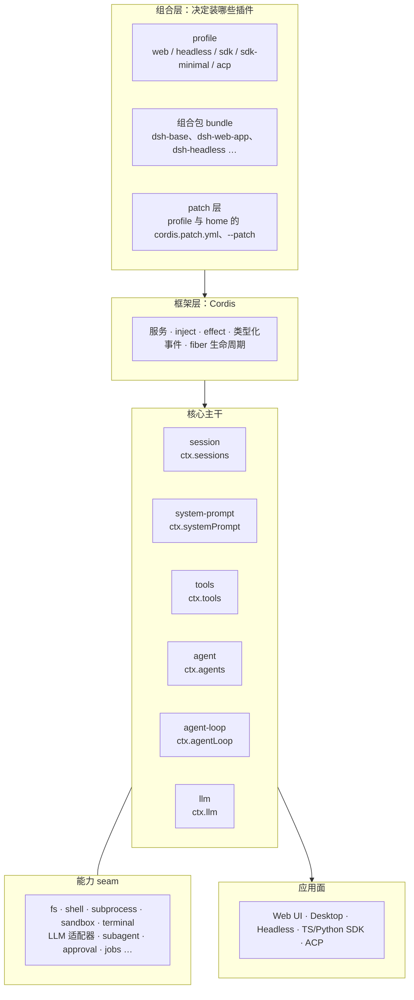

# 一切皆插件：DeepSeek Harness 架构总览

> 系列第 1 篇。本文回答：dsh 由哪几层组成？“一切皆插件”具体指什么？想给 dsh 加一个新行为，应该把代码放在哪里？

## 为什么从架构讲起

一个 coding agent 的功能清单大同小异：调用模型、执行工具、管理会话、展示界面。真正拉开差距的是这些功能怎样组织在一起。常见做法是写一个中心化的 agent loop，再在上面开若干 hook。这样起步快，但 loop 很快会变成所有需求的汇合点：加一种模型要改它，加一种审批策略要改它，换一种持久化后端也要改它。

DeepSeek Harness（下文简称 dsh）走的是另一条路。它的 README 第一句就交代了架构立场：

> It is built on an **everything-is-a-plugin** architecture and powered by Cordis.

上游的[架构文档](https://github.com/deepseek-ai/deepseek-harness/blob/687f282e8625c6b8d11ff58211a90524be2e4317/docs/architecture.zh.md)说得更直接：产品的每一部分都是插件，包括模型适配器、工具注册表、会话日志，以及 agent loop 本身；**不存在需要打补丁的特权内核**，扩展 dsh 的方式是把插件挂到其他插件旁边。

这句话容易读成口号。本系列要做的，是把它拆成可以验证的工程事实。

## 一张分层地图

先给出全貌。下图是按职责划分的五层，箭头表示“由谁组装出谁”，不表示调用方向。



- **组合层**决定这次启动要装哪些插件。profile 是具名组装，组合包（bundle）是一组可分发的配置行，patch 按 id 替换或插入配置行。同一套 dsh 安装由此变成 Web、Headless、SDK 等不同应用（[第 3 篇](03-profiles-bundles-and-boot.md)）。
- **框架层**是 Cordis。它只提供几样东西：服务容器、依赖声明、可撤销的副作用和类型化事件。dsh 的一切都建立在这几样东西之上（[第 2 篇](02-cordis-foundation.md)）。
- **核心主干**是每个对话组合都会启动的几个包。它们之间也通过服务和事件连接，没有谁直接 import 谁的实现。
- **能力 seam** 是可替换的能力：文件系统、进程、沙箱、模型提供方、子代理等。每项能力由“定义、提供方、消费方”三种角色组成，换掉提供方即可改变产品行为（[第 7 篇](07-capability-seams.md)）。
- **应用面**是最终用户接触到的形态。它们同样是插件，驱动 `ctx.agents` 并从会话事件渲染界面。

## 核心主干：六个服务包与一个库

dsh 仓库有超过一百个包，但一轮对话真正依赖的主干很小。上游[核心子系统文档](https://github.com/deepseek-ai/deepseek-harness/blob/687f282e8625c6b8d11ff58211a90524be2e4317/docs/subsystems/core.zh.md)列出了它们：

| 包 | 职责 | 服务键 |
|---|---|---|
| `core/session` | 仅追加的 `SessionEvent` 日志与内存 store，唯一真源 | `ctx.sessions` |
| `core/system-prompt` | 提示词片段与工具 schema 的组装 | `ctx.systemPrompt` |
| `core/tools` | 带作用域的工具注册表与受把关的执行流水线 | `ctx.tools` |
| `core/agent` | `Agent` 接口、活跃 agent 注册表与 `agent/*` 事件词汇 | `ctx.agents` |
| `core/agent-loop` | 实现 `Agent` 接口的默认驱动器 | `ctx.agentLoop` |
| `llm/llm` | 消息与流式词汇表，以及模型适配器 seam | `ctx.llm` |
| `core/scope` | 按 agent 划分作用域的注册原语（零依赖库，不是服务） | 无 |

一个轮次按同一条路径流经这些包：agent-loop 中的驱动器领取一条排队的输入，在会话日志上开启轮次；通过 system-prompt 组装提示词和工具 schema；从日志派生出模型历史；经 `ctx.llm` 流式获取模型响应；经 `ctx.tools` 分发工具调用；最后把每个模型可见的事实追加回日志，供下一步派生（[第 4 篇](04-turn-lifecycle.md)）。

有一个细节值得注意：**扩展插件依赖 `agent`，从不直接依赖 `agent-loop`**。`agent` 包只声明接口和注册表，`agent-loop` 通过 `ctx.agents.setFactory()` 把自己注册成工厂。UI、SDK、子代理插件要创建 agent 时调用 `ctx.agents.create()`，不知道背后是哪个循环实现。所以“agent loop 也是插件”并不是夸张的说法：换一个实现同一接口的驱动器，上层插件无需改动。

最小的完整组合可以在 `sdk-minimal` 组合包里看到。它不叠加 `dsh-base`，而是把整棵配置树显式写出来。下面是其中与核心主干相关的几行（节选自 [`packages/bundle/sdk-minimal/cordis.patch.yml`](https://github.com/deepseek-ai/deepseek-harness/blob/687f282e8625c6b8d11ff58211a90524be2e4317/packages/bundle/sdk-minimal/cordis.patch.yml)）：

```yaml
- insert:
    - id: llm-deepseek
      name: '@deepseek-ai/dsh-llm-deepseek-api-key'
      config:
        apiKeyEnv: DEEPSEEK_API_KEY
    # ...
    - id: llm
      name: '@deepseek-ai/dsh-llm'
    - id: session
      name: '@deepseek-ai/dsh-session'
    - id: system-prompt
      name: '@deepseek-ai/dsh-system-prompt'
      config:
        includeHarnessIdentity: false
        includeRuntimeContext: false
        personaPrefix: !!js process.env.DSH_SYSTEM_PROMPT ?? 'You are a helpful software engineer assistant.'
    - id: tools
      name: '@deepseek-ai/dsh-tools'
    - id: agent
      name: '@deepseek-ai/dsh-agent'
    - id: agent-loop
      name: '@deepseek-ai/dsh-agent-loop'
      config:
        agents: []
    - id: sessions
      name: '@deepseek-ai/dsh-session-persistence-jsonl'
```

这几行的先后顺序不影响加载。Cordis 按服务依赖决定激活时机：`agent-loop` 声明需要 `sessions`、`systemPrompt`、`tools`、`llm` 等服务，这些服务就绪之前它一直处于等待状态。配置文件只回答“装什么”，“什么时候装好”由依赖关系回答。

## 三个事件域

服务负责直接调用，事件负责扩展。上游架构文档把“选对事件域”称为大多数改动的第一个决定。dsh 的事件分为三个域：

| 事件域 | 例子 | 性质 | 什么时候用 |
|---|---|---|---|
| 会话事件 | `turn/start`、`user/message`、`assistant/message`、`tool/result` | 持久事实，追加到日志并通过 `session/event` 广播 | 某个事实在重新加载后必须仍然存在 |
| Agent 事件 | `agent/pre-step`、`agent/request`、`agent/turn-stopping`、`agent/assistant-stream` | 实时扩展点，携带活跃的 `Agent` | 观察或拦截进行中的工作 |
| 能力事件 | `tools/pre-execute`、`fs/write-intent`、`llm/stream` | 附在某个 seam 上的策略与适配器 | 不导入循环就给某项能力加策略 |

区分持久事实和实时控制，是 dsh 能做回放、fork 和崩溃恢复的前提。UI 想渲染可回放的对话记录，应当消费 `session/event`；想在请求发出前改写参数，应当监听 `agent/request`。两类需求走两条通道，互不污染。

## 两条贯穿全局的不变式

读 dsh 源码时，有两条规则几乎在每个包里都能看到它的影子。上游的 `AGENTS.md` 把它们列为仓库约定。

**第一条：模型可见即已记录（Model-visible ⟺ logged）。** 任何进入模型请求的内容，都必须能从会话日志重建。新增一种模型可见的输入，就要新增一种会话事件。系统提示词也不例外：它以 `system/message` 事件的形式进入日志，而不是作为请求的一个旁路字段。这条规则让“模型当时到底看到了什么”永远有确定的答案（[第 5 篇](05-session-log.md)）。

**第二条：用插件扩展，不改循环（Plugins, not loop changes）。** 新行为挂到已有文档记录的扩展点上。改动 agent-loop 本身是例外情况，而且必须同步更新架构文档。上游给出了一张“新行为的归属位置”映射表，这里摘几行：

| 目标 | 机制 |
|---|---|
| 添加模型提供方 | 在 `ctx.llm` 上注册适配器 |
| 添加面向模型的能力 | 在 `ctx.tools` 上注册工具，其 schema 自动加入提示词组装 |
| 拦截请求、工具或轮次 | 监听相应的 `agent/*` 或 `tools/*` 事件 |
| 添加模型可见上下文 | 调用 `agent.inject()`，它会落到下一次获准的请求中 |
| 添加持久会话状态 | 通过声明合并扩展 `SessionEventMap`，从日志渲染和回放 |
| 将注册项限定到单个 agent | 用该 agent 的 `agent.ctx` 注册 |
| 在新后端存储会话 | 实现 `SessionPersistence`（`create`/`open`/`stat`/`list`/`export`） |

这张表的意义在于：功能需求和扩展点之间有一一对应关系。新人拿到需求，先查表找到扩展点，再去读那个扩展点的约定，而不是在循环里找地方插一行 `if`。

## 这种设计的代价

“一切皆插件”不是免费的。读源码或写插件时会碰到下面几种成本：

- **间接层多。** 想知道 `ctx.tools.execute()` 最终调到哪里，需要知道当前组合挂了哪些 `tools/*` 监听器、哪些 guard、哪个审批服务。单看代码无法回答，要结合配置树。`dsh --profile web --dump-config` 能打印出实际生效的配置树，排查问题时应当先跑它。
- **缺依赖时静默等待。** Cordis 插件在依赖未满足时处于 PENDING 状态，这是合法状态，不报错也不输出。插件“没反应”时，第一件事是检查它的 fiber 状态（[第 2 篇](02-cordis-foundation.md)）。
- **事件纪律要靠约定。** waterfall 监听器必须调用 `next()` 才能把控制权交给下游，忘记调用就会悄悄吞掉后面所有逻辑。dsh 用文档、生成的事件目录和测试来约束，但编译器帮不上忙。
- **API 尚未稳定。** dsh 处于 developer preview，公开 API 和事件签名还在频繁变化。上游要求每个外部可感知的破坏性变更都写进升级指南，第三方插件需要跟着版本走。

这些代价换来的是：模型提供方、持久化后端、执行环境、审批策略乃至 agent loop 都可以从配置替换；任何注册都能在卸载时干净撤销，因此支持热重载；所有模型可见的输入都有日志可查。后面几篇会逐一展开这些收益是怎样实现的。

## 小结

- dsh 分为组合层、Cordis 框架层、核心主干、能力 seam 和应用面五层。
- 核心主干只有 session、system-prompt、tools、agent、agent-loop、llm 六个服务包和一个 scope 库；agent loop 通过工厂注册接入，上层插件不依赖它的具体实现。
- 事件分为会话事件（持久）、Agent 事件（实时）和能力事件（策略）三个域。
- “模型可见即已记录”和“用插件扩展，不改循环”是贯穿全局的两条不变式。

下一篇进入框架层：[Cordis：可撤销的服务、effect 与事件](02-cordis-foundation.md)。

## 参考

- [DeepSeek Harness README](https://github.com/deepseek-ai/deepseek-harness/blob/687f282e8625c6b8d11ff58211a90524be2e4317/README.md)
- [DeepSeek Harness 架构](https://github.com/deepseek-ai/deepseek-harness/blob/687f282e8625c6b8d11ff58211a90524be2e4317/docs/architecture.zh.md)
- [核心子系统](https://github.com/deepseek-ai/deepseek-harness/blob/687f282e8625c6b8d11ff58211a90524be2e4317/docs/subsystems/core.zh.md)
- [仓库约定 AGENTS.md](https://github.com/deepseek-ai/deepseek-harness/blob/687f282e8625c6b8d11ff58211a90524be2e4317/AGENTS.md)
- [sdk-minimal 组合包](https://github.com/deepseek-ai/deepseek-harness/blob/687f282e8625c6b8d11ff58211a90524be2e4317/packages/bundle/sdk-minimal/cordis.patch.yml)
