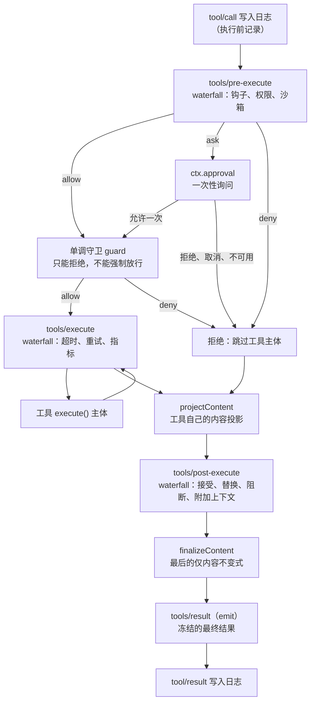

# 提示词组装与工具流水线

> 系列第 6 篇。本文回答：dsh 的系统提示词由谁写、按什么顺序拼？一个插件怎样只给某个 agent 加一段提示词？模型调用一个工具时，从 `tool/call` 到 `tool/result` 中间经过了哪些关卡，哪些插件可以在哪里说“不”？

这两部分放在一起讲，是因为它们共同决定了“模型知道自己能做什么、实际被允许做什么”。提示词和工具 schema 是请求里最占 token 的部分，工具流水线则是安全策略的落点。

## 第一部分：系统提示词是组装出来的

在 dsh 里，没有哪个文件写着完整的系统提示词。`dsh-system-prompt` 提供 `ctx.systemPrompt`，它是一个注册表：各个插件往里贡献输入，每个模型步骤开始前，agent-loop 调用一次 `assemble()` 把它们组装起来（[第 4 篇](04-turn-lifecycle.md)中 pre-step 之前的那一步）。

### 四种输入

注册表接受四种输入，对应 [`SystemPrompt`](https://github.com/deepseek-ai/deepseek-harness/blob/687f282e8625c6b8d11ff58211a90524be2e4317/packages/core/system-prompt/src/index.ts) 服务上的四个方法：

| 方法 | 输入 | 最终去向 |
|---|---|---|
| `section(section)` | 提示词片段：`name`、`order`、静态文本或按上下文求值的函数 | 拼进系统提示词 |
| `context(context)` | 动态运行时上下文：同样有 `name`、`order`、文本 | 作为 user 角色的快照进入模型历史 |
| `variable(name, provider)` | 变量，供文本中的 `{{name}}` 引用 | 渲染时插值 |
| `tools(provider)` | 工具 schema 提供方 | 作为请求的工具定义 |

每个方法都返回 disposer，也就是 Cordis effect。插件卸载后，它贡献的片段、变量和工具就从下一次组装中消失。

片段（section）和上下文（context）的区分很关键。片段是相对稳定的指令，拼成系统提示词；上下文是会变化的运行时事实（比如工作目录），循环会把它作为一条带来源标记的 `user/message` 快照写进历史，**只在完整快照变化或被压缩移除时才重新记录**。这样频繁变化的事实不会反复改写系统提示词，也就不会反复打破 KV cache 前缀（[第 5 篇](05-session-log.md)）。

### 顺序由数字决定，而不是加载顺序

插件的加载顺序由 Cordis 依赖解析决定，不可预测。所以片段的顺序必须显式给出：先按 `order` 升序，相同时按名称的代码单元顺序。仓库自带的片段位置集中定义在一张表里，贡献方通过 `getSectionOrder(name)` 取值，而不是各自硬编码一个数字：

```ts
const SECTION_ORDERS = {
  HARNESS_IDENTITY: -1000,
  DEPLOYMENT_PERSONA_PREFIX: 0,
  PLAN_POLICY: 500,
  TEAM_POLICY: 600,
  PTC_ONLY: 800,
  FILE_REFERENCE: 900,
  TOOL_BASH: 1000,
  TOOL_PWSH: 1010,
  TOOL_READ: 1100,
  TOOL_WRITE: 1200,
  TOOL_EDIT: 1300,
  // ...
  MCP_SERVERS: 3100,
  TOOLS_SDK: 5000,
  DELIVERABLE_FILE_REFERENCES: 9000,
  STRUCTURED_OUTPUT: 9900,
```

（节选。）从这张表可以直接读出 dsh 系统提示词的骨架：harness 身份 → 部署人设 → 计划与团队策略 → 各工具的使用说明 → MCP 服务器 → 结构化输出要求。第三方插件可以使用任意有限的数字，插到骨架中任意位置。

工具 schema 的顺序同理：注册顺序只是插件加载的副产物，组装时会按配置的 `toolOrder` 或字典序规范化。顺序稳定是 KV cache 复用的前提。

### 作用域：只影响一个 agent

通过 `agent.ctx` 注册的片段、变量和工具提供方只对该 agent 生效，并遮蔽同名的全局项。`assemble()` 的实现把这条规则写得很清楚（节选）：

```ts
async assemble(context: AssembleContext = {}): Promise<PromptAssembly> {
  const scope = context.scope
  const scopeLayers = this.layers.chainLayers(scope)
  // Scoped variables shadow globals.
  const variables: Record<string, string | undefined> = {}
  for (const [name, provider] of this.layers.global.variables.entries()) {
    variables[name] = provider(context)
  }
  // Scope-chain variables, farthest first, so the nearest scope wins a name.
  for (const layer of scopeLayers) {
    for (const [name, provider] of layer.variables.entries()) {
      variables[name] = provider(context)
    }
  }
  // Scoped sections shadow globals before the deterministic order sort.
  const sectionByName = this.layers.merge(scope, layer => layer.sections)
  const contextByName = this.layers.merge(scope, layer => layer.contexts)
  // ...
```

先全局、再从远到近遍历作用域链，最近的作用域赢得同名项；片段和上下文按名字合并后再排序。

> Harness Explorer 的 `prompt-contributor` 课程演示了作用域覆盖：同一个片段名在全局和某个 agent 作用域各注册一次，两个 agent 组装出的提示词不同。`system-prompt` 课程则逐段导读了上游的组装与渲染代码。

### 协作组装与严格渲染

收集完输入后，组装还要经过一个 `system-prompt/assemble` waterfall。监听器可以改写片段、上下文、工具列表和变量，这是给需要全局视角的“专家插件”留的口子，同样按作用域过滤分发。

有两个特殊规则：

- **complete 片段**：设置 `complete: true` 的片段会在组装完成后成为唯一的提示词片段，用于“我要完全接管系统提示词”的场景。生效的 complete 片段超过一个时，组装直接失败。
- **严格插值**：`renderPrompt()` 对未设置 `interpolate: false` 的片段做 `{{variable}}` 插值，删除空片段，用空行连接。未知变量、已注册但无值的变量、格式错误的插值组**都会抛错**。上游 README 的原话是：格式错误的提示词比明确失败更糟。一个具体的后果是：自定义人设里写 `Your working directory is {{cwd}}.` 会让组装失败，因为循环并不注册 `cwd` 变量，工作目录由专门的服务以上下文的形式提供。

```ts
export function renderPrompt(assembly: PromptAssembly): string {
  return assembly.sections
    .map(section => section.interpolate === false ? section.text : interpolate(section, assembly.variables, 'section'))
    .filter(text => text.length > 0)
    .join('\n\n')
}
```

### 工具 schema 为什么属于提示词组装

适配器在 wire 上把工具 schema 作为独立字段发送，但 dsh 把它放在提示词组装的结果里（`PromptAssembly.tools`）。理由是“模型获知自己能做什么”是一个整体：工具说明片段和工具 schema 应当在同一次组装中、按同一个作用域决定。`ToolRuntime` 会自动注册自己为工具 schema 提供方，所以大多数工具插件只需要 `ctx.tools.register()`，schema 就会出现在下一次组装中。

提供方返回的 `ToolProviderResult` 里还有一个 `knownNames` 字段：限制前的工具名全集。它让配置校验能区分“工具名拼错了”和“这个工具在当前作用域被有意隐藏”，属于“配置错误要响亮失败”原则的一个细节。

## 第二部分：一次工具调用的完整旅程

`ctx.tools` 不只是注册表，它还拥有执行流水线。模型返回的 `tool-call` 块在 agent-loop 中被调度后，每一次调用都要走下面这条路（据上游[工具执行流水线](https://github.com/deepseek-ai/deepseek-harness/blob/687f282e8625c6b8d11ff58211a90524be2e4317/docs/tool-execution-pipeline.zh.md)简化）：



逐个关卡看。

### 1. `tool/call` 先落日志

调用开始前，`tool/call` 事件已经写进会话日志，记录模型给出的原始参数字符串。即使后面任何一步失败或被取消，日志里也有这次调用的记录，最终一定会有配对的 `tool/result`（[第 4 篇](04-turn-lifecycle.md)讲过取消时如何补写）。

### 2. `tools/pre-execute`：可扩展的前置策略

这是一个 waterfall，监听器返回一个 `PreToolDecision`：

```ts
export type PreToolDecision =
  | { kind: 'allow' }
  | { kind: 'deny'; reason: string; info?: ToolErrorInfo }
  | { kind: 'cancel' }
  | { kind: 'ask'; reason?: string; displayReason?: { readonly en: string; readonly [locale: string]: string } }
```

调用 `next()` 等于委托下游，默认是 `allow`。钩子桥接、权限预设、沙箱策略都挂在这里。`ask` 会交给 `ctx.approval` 做一次性询问；**没有审批服务、或者审批无法作答时，`ask` 一律变成拒绝**。这个默认值很重要：在无人值守的模式下，所有“需要问人”的操作都会被安全地拒绝，而不是放行。

一个示意性的前置策略插件（参照 `tools/pre-execute` 的事件签名编写，不是上游代码）：

```ts
// 示意：在某个 agent 作用域里禁止 bash 调用 rm -rf
agent.ctx.on('tools/pre-execute', async (exec, next) => {
  // exec.arguments 的类型是 unknown，由工具自己校验 schema，这里先收窄
  const args = exec.arguments as { command?: unknown } | null
  const command = exec.name === 'bash' && typeof args?.command === 'string' ? args.command : ''
  if (command.includes('rm -rf')) {
    return { kind: 'deny', reason: 'Recursive deletion is not allowed in this session.' }
  }
  return next()   // 不拥有决策时必须委托
})
```

因为是通过 `agent.ctx` 注册的，这个监听器只会收到该 agent 的调用，agent 销毁时自动移除。

> Harness Explorer 的 `tool-guard` 课程正是围绕这个事件编写的：委托、洋葱顺序、短路拒绝分阶段演示，并能看到被拒绝的调用怎样作为错误结果回到模型。

### 3. 单调守卫：拒绝权的下限

`tools/pre-execute` 是可扩展的，任何监听器都能决定结果，包括放行。有些策略不能被后来者推翻，比如工作区写入边界。为此 `ctx.tools.guard(guard)` 提供了另一种机制：

- 守卫是同步函数，返回一个字符串就表示拒绝；
- 在所有 `tools/pre-execute` 监听器之后、审批通过之后运行；
- **任何一个匹配的守卫都可以拒绝，没有任何守卫能强制放行别人拒绝的调用**。

“单调”指的就是这一点：增加守卫只会让允许的集合变小。waterfall 的灵活性和守卫的不可推翻性由两种机制分别承担。dsh 包级约定里有一条与此呼应：**在做出决策的那个操作里强制执行决策**。从 schema 里隐藏工具、在提示词里写“不要用”、调整监听器顺序，都不算强制执行，因为直接调用方可以绕过它们；拒绝必须在执行器里测试。

### 4. `tools/execute`：环绕分发

通过所有关卡后，调用进入 `tools/execute` waterfall，它包裹着工具主体的执行，适合做超时、重试、指标采集。约束是：包装层只能替换 `exec.signal`，调用身份不可变；注册表在执行主体前会把调用方原始的取消信号重新融合进来，所以包装层无法让调用脱离调用方的取消。

工具主体内部还可能触发其他 seam 的事件。比如 `tool-fs` 的写和编辑会经过 `fs/write-intent` / `fs/edit-intent`，先读后改的检查就在这里实现；一些工具还会写自己的会话事件（`todo/write`、`fs/observed` 等）。

### 5. `tools/post-execute`：改写结果

工具执行完（包括抛错的情况，抛错也会以错误结果到达这里），`tools/post-execute` waterfall 拿到结果，返回 `PostToolDecision`：

```ts
export type PostToolDecision =
  | { kind: 'accept'; content?: ContentBlock[]; value?: never; additionalContexts?: UserMessage[] }
  | { kind: 'accept'; value: JsonValue; content?: never; additionalContexts?: UserMessage[] }
  | { kind: 'block'; feedback: ContentBlock[]; additionalContexts?: UserMessage[] }
```

可以原样接受、替换内容或值、用纠正性反馈把结果阻断成错误，还可以附加 `additionalContexts`。附加的上下文不会插在工具结果中间，而是在这一批工具结果全部记录之后，按先进先出顺序作为 `user/message` 注入，保证工具调用和结果在历史中紧密相邻。

### 6. 规范化、`finalizeContent` 与 `tools/result`

最后几步保证结果可以安全落盘：

- 注册表对候选结果做无损快照；快照失败或流水线中任何一处抛错，都会被规范化成 `isError` 结果，而不会中止轮次；
- 工具定义自己的 `finalizeContent` 强制执行最后的仅内容不变式；
- `tools/result` 以 emit 方式发布冻结的、可无损 JSON 表示的最终结果，监听器失败被隔离；
- 循环把它写成 `tool/result` 会话事件，这是模型看到的唯一结果。

工具的“规范值”与“渲染内容”是分开的：`execute` 返回 `output.schema` 声明的值，`output.render` 生成写入日志、给模型看的内容。替换或脱敏内容不会影响程序化调用方读到的规范值，真要禁止访问，策略必须阻止执行或替换值本身。

### PTC 模式

`dsh-tools` 支持两种呈现模式：原生 Function Calling，以及 PTC（programmatic tool calling）模式。PTC 模式下，模型通过保留的 `run_code` 工具写一段程序来编排多个工具调用。程序里的每一次子调用同样被送进这条流水线，携带父级 token，记录 `tool/ptc-dispatch`，拒绝会被呈现为有约束力的驳回，并省略 `additionalContexts`。换句话说，换了呈现方式，安全策略不需要重写。

## 设计要点回顾

把两条流水线放在一起，可以看到几条共同的设计取向：

- **贡献分散，组装集中。** 提示词片段、工具、策略都由各自的插件贡献，组装和执行由唯一的服务负责，顺序由显式数字和规范化规则决定，与加载顺序无关。
- **可扩展与不可推翻分开。** waterfall 负责可协商的决策，单调守卫负责不可推翻的拒绝。
- **安全默认值。** `ask` 在没有审批者时变成拒绝；格式错误的提示词直接失败；流水线异常变成错误结果而不中止轮次。
- **作用域贯穿始终。** 提示词、变量、工具、监听器都可以只对一个 agent 生效，并在它销毁时自动撤销。

代价是一次工具调用的行为由多个插件共同决定，单看工具代码无法预测结果。排查时需要结合 `--dump-config` 看当前组合挂了哪些策略插件，并在 `tools/result` 或会话日志中观察最终结果。

## 小结

- 系统提示词由 `section`、`context`、`variable`、`tools` 四类输入组装而成，顺序由显式 `order` 决定，作用域贡献遮蔽全局。
- 动态事实走 context，以 user 快照进入历史，避免反复改写系统提示词。
- 工具调用经过 `tool/call` → pre-execute → 守卫 → 审批 → execute → post-execute → finalize → `tools/result` → `tool/result`。
- waterfall 负责可协商的策略，单调守卫负责不可推翻的拒绝，`ask` 在无人可问时默认拒绝。

最后一篇回到“可替换”这个主题：[能力 seam：换一个提供方，换掉整个产品](07-capability-seams.md)。

## 参考

- [system-prompt README](https://github.com/deepseek-ai/deepseek-harness/blob/687f282e8625c6b8d11ff58211a90524be2e4317/packages/core/system-prompt/README.zh.md)
- [系统提示词组装子系统](https://github.com/deepseek-ai/deepseek-harness/blob/687f282e8625c6b8d11ff58211a90524be2e4317/docs/subsystems/system-prompt.zh.md)
- [`system-prompt/src/index.ts`](https://github.com/deepseek-ai/deepseek-harness/blob/687f282e8625c6b8d11ff58211a90524be2e4317/packages/core/system-prompt/src/index.ts)
- [工具执行流水线](https://github.com/deepseek-ai/deepseek-harness/blob/687f282e8625c6b8d11ff58211a90524be2e4317/docs/tool-execution-pipeline.zh.md)
- [tools README](https://github.com/deepseek-ai/deepseek-harness/blob/687f282e8625c6b8d11ff58211a90524be2e4317/packages/core/tools/README.zh.md)
- [`tools/src/index.ts`](https://github.com/deepseek-ai/deepseek-harness/blob/687f282e8625c6b8d11ff58211a90524be2e4317/packages/core/tools/src/index.ts)
