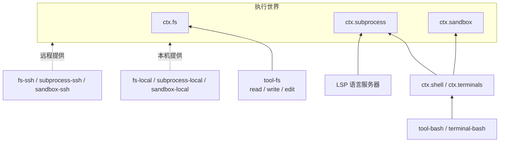

# 能力 seam：换一个提供方，换掉整个产品

> 系列第 7 篇，也是最后一篇。本文回答：dsh 所说的“能力 seam”是什么？为什么替换一个提供方就能把 Bash、终端、语言服务器一起搬到远程机器上？设计一个新能力时要遵守哪些规则？

## 什么是 seam

上游架构文档给 seam 的定义是：**一项可替换能力，包含三种角色**。

- **Service Definition（服务定义）**：声明 Cordis 服务的接口，以及请求和结果类型。
- **Service Provider（服务提供方）**：实现这个接口。
- **Consumer（消费方）**：使用它，通常是一个面向模型的工具。

一个包可以同时承担多个角色，但**单一角色本身不是 seam**。添加一项能力，意味着把三种角色一起设计。只有在角色需要独立演进或替换时，才把它们拆进不同的包。

这和依赖倒置原则是同一回事，只是 dsh 把它落实到了包结构和 Cordis 服务上：提供方依赖定义，消费方依赖定义，**提供方和消费方互不依赖**。消费方通过 `inject` 声明需要某个服务名，配置决定由哪个提供方来满足（[第 2 篇](02-cordis-foundation.md)）。

## 例一：Bash

上游开发文档用 Bash 执行作为标准例子：

```text
┌──────────────┐     ┌──────────────────┐     ┌───────────────┐
│  dsh-shell   │────▶│  dsh-bash-local  │     │ dsh-tool-bash │
│ (definition) │     │    (provider)    │     │  (consumer)   │
└──────────────┘     └──────────────────┘     └───────────────┘
       ▲                                              │
       └──────────────────────────────────────────────┘
                       inject: ['shell']
```

- `dsh-shell` 定义 `ctx.shell` 服务和 Bash 请求、结果类型；
- `dsh-bash-local` 在本机执行命令；
- `dsh-tool-bash` 把这项能力包装成模型可调用的 `bash` 工具。

rc.2 的 `packages/shell/` 下能看到同一个定义的多个实现：`bash-local`、`bash-sandbox`、`pwsh-local`、`pwsh-sandbox`。`dsh-base` 默认挂的是 `bash-sandbox`，Windows 上按平台换成 `pwsh-sandbox`，用的就是第 3 篇讲的 `disabled: !!js process.platform === 'win32'` 二选一写法。工具包 `tool-bash` 不知道背后是哪个实现。

拆分的收益在上游文档里列得很清楚：

- **提供方可替换**：更换提供方时，定义和工具都不变；
- **独立演进**：定义一旦有调用方依赖就很少改动，提供方可以独立优化性能和安全性，消费方可以调整向模型呈现的方式；
- **依赖解耦**：提供方和消费方之间没有 import 关系。

## 例二：把执行环境整个搬到远程

单个 seam 的替换只影响一项能力。dsh 更有意思的地方在于：**文件系统与进程提供方共享同一个执行世界**。上游架构文档的原话是，把它们指向远程沙箱，也就把 Bash、PTY 和 LSP 一并搬了过去，无需为提供方专门 fork。

rc.2 的 `packages/ssh/` 就是这样一组提供方：

| 包 | 提供的服务 | 作用 |
|---|---|---|
| `dsh-ssh` | 连接 | 连接到 SSH 主机上已安装的辅助程序，认证和主机身份由部署方的 OpenSSH 主机别名提供；连接就绪前校验辅助程序摘要 |
| `dsh-fs-ssh` | `ctx.fs` | 在远端文件系统上读写；文件工具看到的文件与远端 Bash、终端、语言服务器看到的一致 |
| `dsh-subprocess-ssh` | `ctx.subprocess` | 在远端启动普通进程和终端会话 |
| `dsh-sandbox-ssh` | `ctx.sandbox` | 远端选择本机安装的沙箱后端，在远端执行每次调用的策略 |

为什么替换这三个服务就够了？因为上层能力都建立在它们之上：



`tool-fs`、Bash、终端和语言服务器都只依赖 `ctx.fs`、`ctx.subprocess`、`ctx.sandbox` 这几个服务名。把本地提供方换成 SSH 提供方，Cordis 会让所有依赖它们的插件重启并用上新实现（`inject` 的持续跟踪），模型使用的工具一个都不用改。架构文档的“新行为归属位置”表里也写明：添加 shell 执行是注册 `ctx.shell` 后端，本地后端通过 `ctx.subprocess` 启动进程；限制所启动的进程是使用 `ctx.sandbox` 后端，消费方在启动进程前包装 argv。

沙箱本身也是 seam。`dsh-fs-sandbox` 是 `ctx.fs` 的另一个提供方，按会话的沙箱模式限制写入：`read-only` 拒绝所有变更，`workspace-write` 只允许写会话工作区或平台临时目录，`danger-full-access` 不限制。`dsh-base` 里的 `sandbox-policy` 行默认读取 `DSH_PERMISSION_MODE`，缺省为 `workspace-write`。

## 例三：模型适配器

`ctx.llm` 是另一个典型 seam。服务定义在 `dsh-llm`，它声明消息与流式词汇（`Message`、`ContentBlock`、`StreamChunk`）和抽象类 `LlmAdapter`；提供方继承 `LlmAdapter`、实现 `stream()`，然后用 `ctx.llm.registerAdapter(providers, adapter)` 注册。rc.2 的 `packages/llm/` 下有：

- `llm-deepseek`：DeepSeek 官方 API 的请求实现；
- `llm-deepseek-api-key`、`llm-deepseek-account`：分别以 API key 和 DeepSeek 账号鉴权，复用 `llm-deepseek` 的请求实现；
- `llm-pi-ai`：基于 pi-ai 库，通过一份配置把请求路由到多个提供方、OpenAI 兼容网关或自托管服务器；
- `llm-retry`：不是适配器，而是监听 `agent/request-error` 的重试策略。

seam 的价值很大程度上取决于约定写得多严。`LlmAdapter` 的约定是这一点的好例子，上游文档列出了每个适配器都必须遵守的规则，摘几条：

- **`usage` 在 `finish` 之前，`finish` 之后不再有任何 chunk。**
- **工具调用参数全程是原始 JSON 字符串**，提供方返回已解析的对象时，适配器在 `block-end` 时重新序列化。
- **一次适配器调用就是一次提供方尝试**，适配器禁用库内重试，重试统一由 agent 层决定（[第 4 篇](04-turn-lifecycle.md)）。
- **上下文溢出只有一个规范错误码** `CONTEXT_WINDOW_EXCEEDED`，消费方按错误码路由，绝不解析提供方的错误文本。
- **空 completion 是可重试错误**（`EMPTY_RESPONSE`），而不是静默的成功。
- **回放状态归适配器所有。** 成功的 `finish` 可以携带不透明的 `ReplayEnvelope`；后续请求中，只有历史提供方和目标提供方注册到同一个适配器实例时才会传回这份状态。换了提供方，其他适配器只会收到与提供方无关的内容。

正因为有这些规则，压缩插件、重试插件、token 计量插件、UI 都可以只针对 `StreamChunk` 和 `LlmFailure` 编写，不需要知道背后是哪家模型。`StreamChunk` 是封闭的可辨识联合，`switch` 以 `assertNever` 结尾，新增变体会在每个必须处理它的消费方处触发编译错误。

## 例四：子代理

子代理是 seam 设计里差异最大的一个。`dsh-subagent` 定义统一的 activation API，面向模型的委派工具是消费方，而提供方从“在同一进程里新建一个 agent”到“把任务交给另一个产品”应有尽有：

| 后端 | 做法 | 适用场景 |
|---|---|---|
| `subagent-spawn-in-process` | 进程内新建一个全新的子 `Agent`，复用宿主的 agent 工厂、LLM 与工具服务；从空对话开始 | 成本最低的委派 |
| `subagent-fork-in-process` | 在父会话已完成的前缀上 fork 出子会话（基于第 5 篇的 fork 原语） | 子任务需要建立在父级已有对话上 |
| `subagent-dsh-sdk` | 启动一个全新的 dsh 子进程，有自己的 profile、会话、模型路由与工具 | 需要完整的 Harness 运行时隔离 |
| `subagent-acp` | 在子进程中运行任意 ACP 兼容的 agent | 进程隔离，或使用非 Harness 的 agent |
| `subagent-claude-code` | 在父工作区中以全新的无人值守 Claude Code 会话运行 | 需要真实的 Claude Code 行为 |
| `subagent-codex` | 在父工作区中以全新的无人值守 Codex 会话运行 | 需要真实的 Codex 行为 |

这些后端的内部实现毫无共同之处，但都在同一个接口之后。服务定义用 `SubagentCapabilities` 声明每个后端支持哪些启动选项（是否接受 `agentOptions`、是否能独立选择 preset、是否支持输出 schema、是否支持深度限制），管理器在准备子代理之前逐项校验请求，不支持的选项直接拒绝，而不是悄悄忽略。外部后端（Claude Code、Codex、ACP、dsh-sdk）都只把最终答案或安全的失败诊断返回给父会话，中间消息和工具流量不会进入父级对话。

## 同一进程里的不同能力集合：agent preset

前面的例子都是在整个应用层面替换提供方。如果想让**某一个会话**拥有不同的能力集合呢？dsh 的答案是 agent preset：在普通 Cordis YAML 里定义一个 agent 的子插件列表，可以同时声明多个 preset，由会话选择。

```yaml
- id: agent-preset-registry
  name: '@deepseek-ai/dsh-agent-preset-registry'
  config:
    default: standard
- id: preset-standard
  name: '@deepseek-ai/dsh-agent-preset'
  config:
    id: standard
    plugins: []
```

preset 里的插件挂在 agent 自己的作用域下。架构文档特别注明：preset 中的**服务行需要 `isolate` realm**，也就是第 2 篇讲的服务隔离。这样一个会话可以拥有自己的 `shell` 或 `fs` 实例，而不会影响同一进程里的其他会话。修改 preset 只影响之后创建的 agent。

## 设计 seam 的规则

dsh 在 `packages/AGENTS.md` 和根目录 `AGENTS.md` 里沉淀了一组设计能力时要遵守的规则。它们对设计任何插件化系统都有参考价值：

1. **为所有现有消费方设计服务定义。** 工具 schema、Loader、UI、传输层或特定提供方的行为放在消费方或提供方里，不要让某一个消费方主导服务约定。反过来，一个只有一个内部调用方的公开服务方法也是坏味道，应当改为传递一个私有的能力闭包。
2. **包边界上显式优于隐式。** 默认值处理应当是所属实现里一个显式的 `resolve(request): Spec` 步骤，而不是藏在 `run()` 里的 `?? default`。`dsh-shell` 的 request / spec 拆分是范本。
3. **插件里没有硬编码的可调参数。** 随部署变化的选择都是经过校验的 `Config` 字段，可以从 `cordis.yml` 修改；一个 `DEFAULT_*` 常量或测试钩子不算可配置。协议常量、外部规范和安全不变式保持固定。
4. **配置错误要响亮失败。** 能在加载时自检的就在加载时失败，否则在最早能判定的时刻失败；绝不静默跳过一个缺失的引用。
5. **在做出决策的操作里强制执行。** 从 schema 中省略、在提示词里过滤、外观封装、监听器顺序都不算强制执行，因为直接调用方或替代调用方可以绕过；拒绝要通过执行器测试（第 6 篇的单调守卫就是这条规则的产物）。
6. **业务规则放在自己的包里。** 运行时、控制器、网关这类层只承担通用编排，业务分支属于独立的包，通过注册接口或投影数据接入。
7. **跨边界的不透明 id 要打品牌。** 使用 `dsh-brand` 的 `Branded<B>`，而不是裸 `string`，`SessionId`、`ToolCallId` 都是这样定义的。

## 回到起点：“一切皆插件”到底换来了什么

系列开头说，“一切皆插件”容易被读成口号。走完七篇，可以把它拆成几项具体的工程能力：

| 能力 | 依赖的机制 | 所在篇目 |
|---|---|---|
| 任意配置行可被用户替换 | profile 与 patch 分层、按 `id` 整行替换 | 第 3 篇 |
| 替换提供方时消费方自动重启 | Cordis `inject` 的持续依赖跟踪、注册即 effect | 第 2 篇 |
| 热重载不留残渣 | effect 可撤销、配置行的稳定 `id` | 第 2、3 篇 |
| 插件改变内核决策而不改循环 | `agent/*`、`tools/*`、`llm/stream` 等 waterfall 扩展点 | 第 4、6 篇 |
| 模型输入可审计、可回放、可 fork | 仅追加会话日志、surface 投影、模型可见即已记录 | 第 5 篇 |
| 单个 agent 拥有不同能力 | `agent.ctx` 作用域注册、preset 与服务隔离 | 第 2、6、7 篇 |
| 一次替换搬走整个执行环境 | fs / subprocess / sandbox 共享执行世界的 seam 设计 | 第 7 篇 |

代价也贯穿全系列：间接层多，读代码要结合配置树；waterfall 纪律靠约定维持；状态转换密集的地方（agent-loop、surface 协调）需要大量文档和测试；API 尚未稳定。dsh 的选择是用生成的目录（配置目录、事件目录、能力图）、严格的仓库约定和快照测试来对冲这些成本。

如果你在设计自己的 agent harness，dsh 未必是要照搬的模板，但其中几条原则值得直接借用：**让持久事实和实时控制走不同的通道；让模型可见的一切都有日志；让每一次注册都可撤销；把能力拆成定义、提供方、消费方三种角色，并把约定写严。**

## 小结

- seam = 服务定义 + 提供方 + 消费方，单一角色不构成 seam。
- 文件系统、进程、沙箱共享执行世界，替换这几个提供方就能把 Bash、终端、LSP 一起搬到远程。
- 模型适配器和子代理是两类差异很大的 seam，靠严格的约定（流协议、错误码、能力声明）让上层代码与具体提供方无关。
- agent preset 配合服务隔离，让同一进程里的不同会话拥有不同的能力集合。

感谢读完这个系列。想看这些机制实际运行起来的样子，可以启动本仓库的 Harness Explorer，在插件树上逐个添加插件，对比两次运行的请求差异。

## 参考

- [能力的三种角色设计](https://github.com/deepseek-ai/deepseek-harness/blob/687f282e8625c6b8d11ff58211a90524be2e4317/docs/user/develop/practice/index.zh.md)
- [能力 seam 与核心服务（能力图）](https://github.com/deepseek-ai/deepseek-harness/blob/687f282e8625c6b8d11ff58211a90524be2e4317/docs/capability-seams.zh.md)
- [架构：能力 seam 与新行为的归属位置](https://github.com/deepseek-ai/deepseek-harness/blob/687f282e8625c6b8d11ff58211a90524be2e4317/docs/architecture.zh.md)
- [LLM 流式输出与适配器约定](https://github.com/deepseek-ai/deepseek-harness/blob/687f282e8625c6b8d11ff58211a90524be2e4317/docs/subsystems/llm-streaming.zh.md)
- [子代理子系统](https://github.com/deepseek-ai/deepseek-harness/blob/687f282e8625c6b8d11ff58211a90524be2e4317/docs/subsystems/subagent.zh.md)
- [SSH 提供方](https://github.com/deepseek-ai/deepseek-harness/tree/687f282e8625c6b8d11ff58211a90524be2e4317/packages/ssh)
- [agent-preset README](https://github.com/deepseek-ai/deepseek-harness/blob/687f282e8625c6b8d11ff58211a90524be2e4317/packages/preset/agent-preset/README.zh.md)
- [包级约定 packages/AGENTS.md](https://github.com/deepseek-ai/deepseek-harness/blob/687f282e8625c6b8d11ff58211a90524be2e4317/packages/AGENTS.md)
